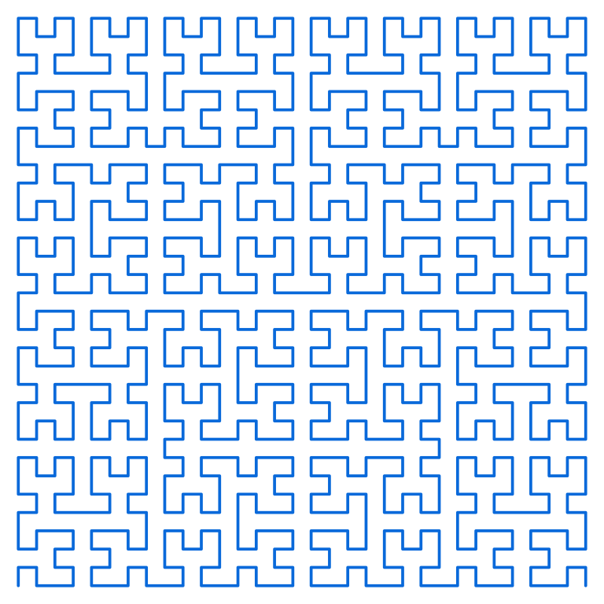

# Fast Life

An exploration in Zig of potential cache locality improvements through Hilbert curve ordering
of cell blocks in Conway's Game of Life. The idea is to keep spatially nearby blocks close in
memory, improving data reuse when processing neighboring cells.

The project includes packed binary grids, Hilbert curve mappings, neighbor-distance analysis,
and Game of Life implementations for experimenting with storage order and block processing.
See the [Hilbert curve implementation note](docs/hilbert_curve_implementation.md) and
[binary grid design](docs/binary_grid_design.md) for details.

Illustrative order-5 traversal: 1,024 blocks in a 32 × 32 block grid. With 4 × 4 cells per
block, this represents a 128 × 128 cell grid.
